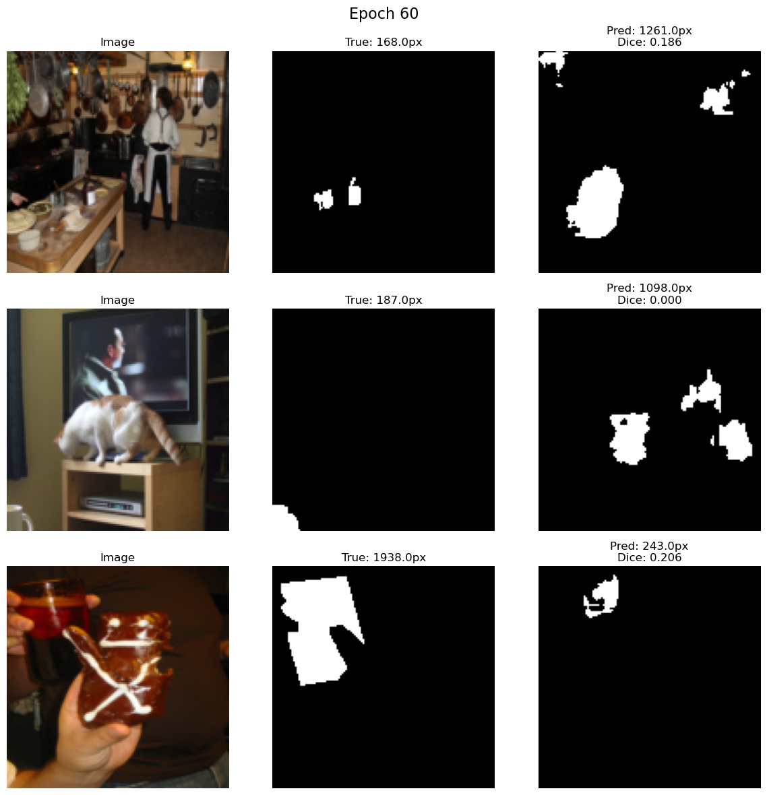
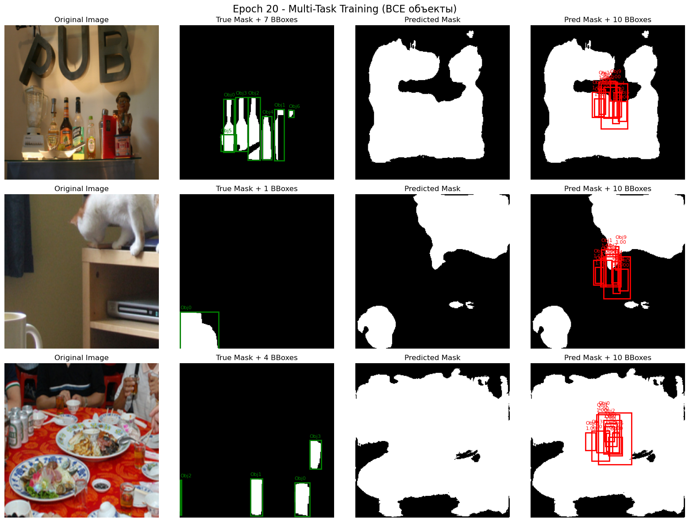
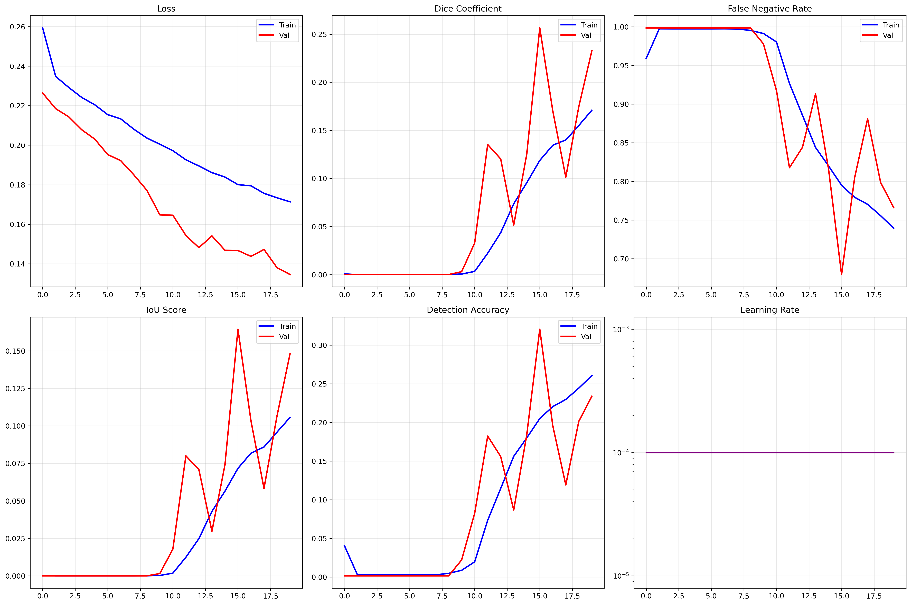

# Vessel Segmentation with U-Net: a Research Pet Project

**Goal:** find vessels (bottles, cups, wine glasses) in everyday photos and, as the next step, estimate the liquid level inside them.
This repository documents the first part: **semantic segmentation of vessels**, trained from scratch in PyTorch on a filtered subset of COCO 2017. Liquid-level estimation was planned but has **not been implemented yet**.

> Status: research / work in progress. The best model reaches **Dice 0.26** on the validation set. The value of the project lies in the experiments and in the analysis of why they behave the way they do, not in a production-ready model.



## Data

| | |
|---|---|
| Source | [COCO 2017](https://cocodataset.org/) (train2017 / val2017) |
| Classes | `bottle`, `cup`, `wine glass`, merged into a single "vessel" mask |
| Filtered set | **15,558** training and **673** validation images |
| Main difficulty | Strong **class imbalance**: vessels usually cover only a few percent of the image pixels |

Preparation scripts are in [`data-preparation/`](data-preparation):

| Script | Purpose |
|---|---|
| `filter_data.py` | Selects images containing the target categories from COCO annotations |
| `validate_dataset.py` | Checks the filtered dataset against the category list |
| `verify_annotations.py`, `verify_annotations_v2.py` | Verifies that every image has valid annotations and removes broken samples |
| `diagnose_images.py` | Finds and fixes images that fail to load |
| `filters/*.json` | IDs of the valid images in the filtered train / val sets |

The images themselves (2.5 GB) are not stored in the repository; they can be rebuilt from COCO 2017 with the scripts above.

## Experiments

All models take **256×256** inputs with ImageNet normalisation and are evaluated with **Dice** and **IoU**.

| # | Notebook | Model | Loss | Training | Best val Dice |
|---|---|---|---|---|---|
| 01 | [`unet_baseline`](experiments/01-first-unet) | U-Net (`DoubleConv` / `Down` / `Up` blocks) | – | First baseline on a bottle-only dataset | – |
| 02 | [`coco_segmentation`](experiments/02-coco-segmentation) | – | – | COCO segmentation dataset class and mask generation | – |
| 03 | [`unet`](experiments/03-unet-tough-loss) | U-Net | **BCE + 3.0 × false-negative penalty + 0.5 × focal** | AdamW, 20 epochs, batch 8, horizontal flip | **0.257** |
| 04 | [`unet-1`](experiments/04-balanced-unet) | Balanced U-Net | BCE-with-logits + FN / FP weights (2.0 / 1.5) + predicted/true area ratio | AdamW, ReduceLROnPlateau, 40 epochs, colour jitter | 0.001 (collapsed) |
| 05 | [`unet-2`](experiments/05-simple-vessel-net) | Lightweight `SimpleVesselNet` | Weighted BCE (`pos_weight` = 8) | Adam, StepLR, 50 epochs, early stopping, cached dataset | 0.176 |
| 06 | [`unet-3`](experiments/06-multi-task) | **Multi-task** `MultiTaskVesselNet`: mask + up to 10 object boxes | Segmentation (weighted BCE) + 0.5 × detection | 50 epochs, **smart zoom** augmentation (crop ×1.0–3.0 around objects) | 0.247 |

## Findings

1. **Class imbalance is the core problem.** With plain BCE the network learns to predict "background everywhere", which already gives a low loss.
2. **Penalising false negatives helps, but not enough.** Experiment 03 reached the best Dice (0.257), yet the model still missed about **77% of vessel pixels** (FN rate on validation).
3. **Over-correcting the imbalance breaks training.** The balanced loss in experiment 04 pushed the network into a degenerate solution (Dice ≈ 0).
4. **The multi-task model flips the error.** In experiment 06 the network marked about **87% of pixels** as vessel while the true share was about **7%**: strong over-prediction. The detection branch, however, trained stably (detection loss ≈ 0.02).
5. **Training dynamics of the multi-task model:** validation Dice grew from 0.16 after the first epoch to 0.25 by epoch 23. A separate ablation would be needed to tell how much of this comes from the smart zoom augmentation.





## Next steps

- Replace BCE-based losses with **Dice / Tversky / Lovász** losses that optimise overlap directly.
- Use a **pretrained encoder** (ResNet / EfficientNet U-Net) instead of training from scratch.
- Train at a higher resolution: thin glass objects lose detail at 256×256.
- Add the **liquid-level** stage: segment the liquid inside the detected vessel mask and compute the fill ratio along the vessel's vertical axis.

## Model weights

The best checkpoints are attached to the [GitHub release](../../releases) instead of the repository:

| File | Experiment | Val Dice |
|---|---|---|
| `best_model.pth` (118 MB) | 03, U-Net with FN penalty | 0.257 |
| `multi_task_vessel_model.pth` (24 MB) | 06, multi-task network | 0.247 |

## How to run

```bash
pip install torch torchvision pycocotools pillow numpy matplotlib opencv-python tqdm
python data-preparation/filter_data.py
jupyter notebook experiments/03-unet-tough-loss/unet.ipynb
```

The notebooks use local paths to the COCO folders; adjust them before running.

## Tech stack

Python · PyTorch · torchvision · COCO API · OpenCV · NumPy · Matplotlib

## License

Code: [MIT](LICENSE). COCO images and annotations are subject to the [COCO terms of use](https://cocodataset.org/#termsofuse).
